<p align="center">
  
</p>

<h1 align="center">Spark Timer</h1>

<p align="center">
  타바타부터 HIIT·EMOM·AMRAP·For Time·휴식 타이머까지,<br>
  탭 한 번으로 시작하는 운동 타이머 · 다크/라이트 모드 · 한국어/English (Flutter · Android / iOS)
</p>
<p align="center"><a href="#english">English</a></p>

<p align="center">
  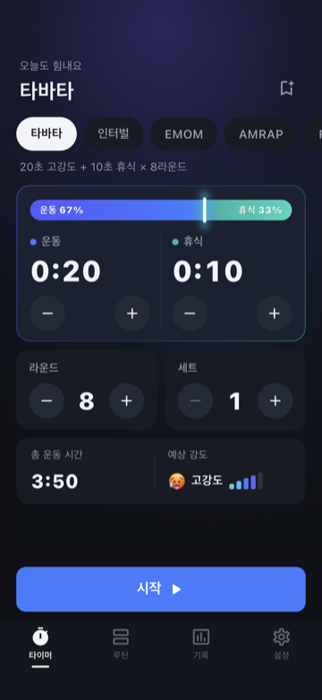
  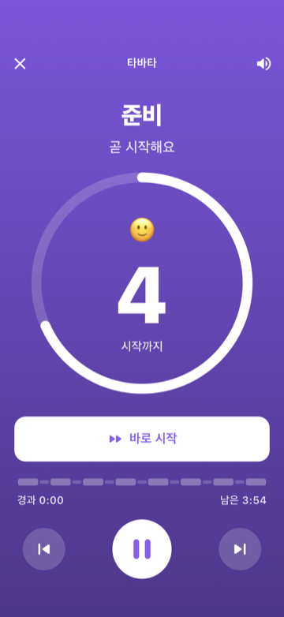
  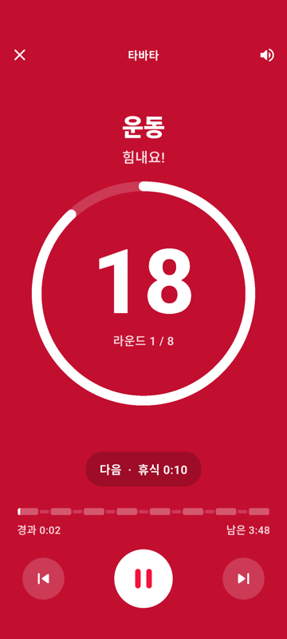
</p>
<p align="center">
  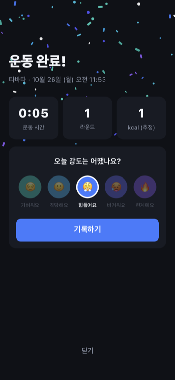
  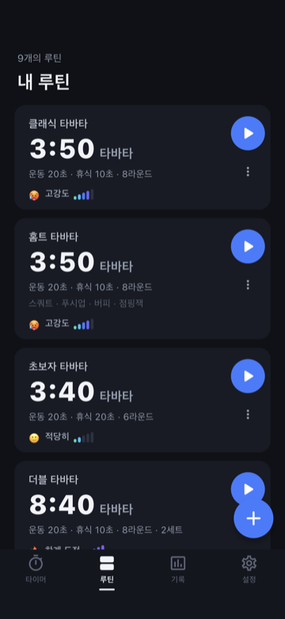
  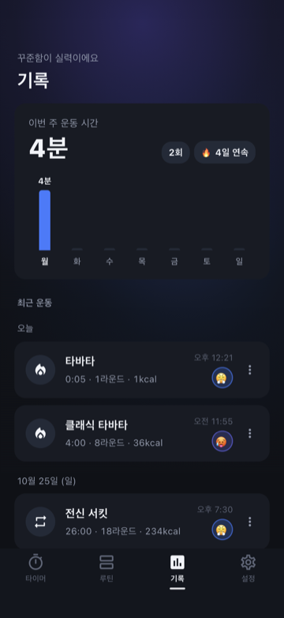
</p>
<p align="center">
  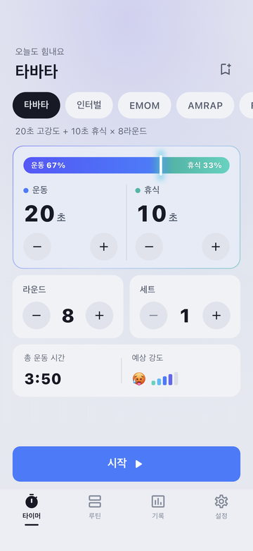
  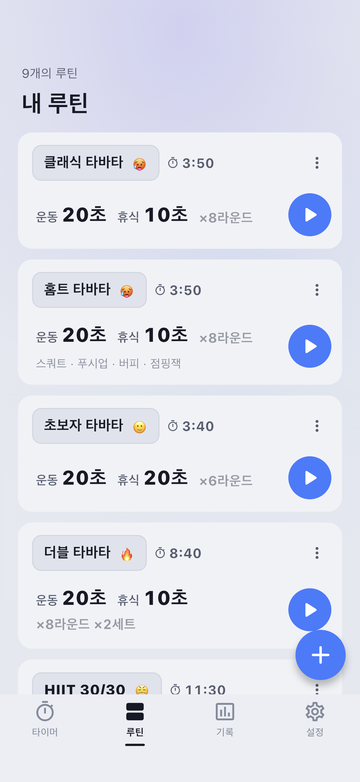
  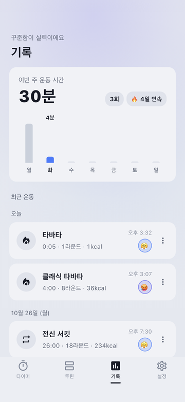
</p>
<p align="center">
  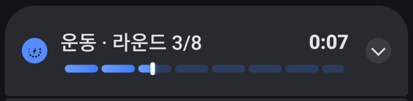
</p>

## 기능

- **6가지 타이머** — 타바타, 인터벌(웜업·세트·쿨다운), EMOM, AMRAP(탭으로 라운드 카운트), For Time(랩·타임캡), 휴식(+15초)
- **원탭 시작** — 모드를 고르고 −/+ 로 조절한 뒤 시작. 숫자를 탭하면 휠로 직접 입력. 운동·휴식은 한 카드로 묶여 그라데이션 비율 막대 안에 ‘운동 67% · 휴식 33%’가 바로 보임. 준비 5초, 카운트다운 중 ‘바로 시작’
- **멀리서도 보이는 운동 화면** — 단계별 풀스크린 그라데이션(운동 애저 · 휴식 틸 · 준비 바이올렛), 초대형 숫자, 원형 진행 링, 전체 타임라인, 다음 단계 미리보기
- **보지 않아도 아는 안내** — 매초 ‘삐-’, 마지막 3-2-1, 구간이 끝나면 긴 ‘삐---’ 뒤 "운동 시작" / "휴식" 음성, 진동. 기기에서 가장 자연스러운 한국어 목소리를 자동 선택(설정에서 미리 듣고 변경)
- **음악과 함께, 화면 꺼져도** — 듣던 음악 위에 안내음이 겹쳐 나오고, 화면이 꺼지거나 음악 앱으로 넘어가도 타이머가 계속 동작(Android 포그라운드 서비스, iOS 백그라운드 오디오)
- **알림창 진행 바** — Android 알림에 현재 구간·라운드·남은 시간과 운동 전체를 라운드 마디로 나눈 그라데이션 진행 바가 접힌 상태에서도 바로 보임
- **강도가 한눈에** — 시작 전 예상 강도(이모지 + 신호 막대), 운동 중 순간 강도에 반응하는 마스코트(💪 → 😤 → 🥵, 휴식 😅 → 😌), 끝난 뒤 체감 강도까지 같은 5단계 이모지·색으로 표시
- **루틴** — 기본 루틴 9종, 라운드별 운동 이름(서킷), 저장·편집·복제·삭제, 최근 루틴 빠른 시작
- **기록** — 완료 화면(축하·요약·칼로리 추정·운동 강도), 주간 차트, 연속 운동일
- **다크 · 라이트 모드** — 기기 설정을 따르거나 직접 선택. 라이트는 눈부시지 않은 차분한 회청색 톤이고, 운동 화면은 멀리서도 잘 보이도록 늘 어둡게
- **한국어 · English** — 기기 언어를 따르거나 설정에서 선택. 화면, 음성 안내, 알림, 기본 루틴 이름, 날짜·시간 표기, 앱 이름까지 바뀜
- **설정** — 효과음·음성·진동, 카운트다운 길이, 준비 시간, 테마, 언어, 화면 켜짐 유지, 체중

## 설치

[Releases](../../releases/latest)에서 Android APK를 받을 수 있습니다 (Android 7.0 이상).
개인 배포용으로 디버그 키로 서명되어 있습니다.

## 개발

```bash
flutter pub get
flutter run                 # 연결된 기기/시뮬레이터
flutter test                # 단위·위젯 테스트
flutter analyze
```

| 작업 | 명령 |
|---|---|
| 화면 스크린샷(통합 테스트) | `flutter drive --driver=test_driver/integration_test.dart --target=integration_test/screenshots_test.dart -d <기기 ID>` → `build/screenshots/` |
| 효과음 재생성 | `python3 tool/gen_sounds.py` |
| iOS 빌드 + App Store 업로드 | `tool/ios_release.sh` (제출 자료: [docs/APP_STORE.md](docs/APP_STORE.md)) |
| 앱 아이콘 재생성 | `python3 tool/gen_icon.py && dart run flutter_launcher_icons` (Chrome 필요) |

## 구조

```
lib/
├─ engine/     단계 계산(workout_plan) · 실행기(workout_runner) · 큐 이벤트 · 강도 추정(intensity)
├─ models/     WorkoutConfig, IntervalStep, WorkoutRecord, AppSettings
├─ data/       설정·루틴·기록·타이머 설정 저장소, AppScope
├─ l10n/       문구(app_en.arb · app_ko.arb)와 생성된 AppLocalizations
├─ services/   CuePlayer(효과음·음성·진동), 앱 언어, 칼로리 추정
├─ theme/      컬러 토큰, ThemeData
└─ ui/         timer · routines · history · settings · workout · widgets
```

기획 배경, 기능 명세, 화면 설계, 로드맵은 [docs/PLANNING.md](docs/PLANNING.md)에 있습니다.

문구를 고치거나 언어를 추가하려면 `lib/l10n/app_*.arb`를 수정한 뒤 `flutter gen-l10n`을 실행하세요.

---

## English

Spark Timer is a workout timer for Tabata, intervals (HIIT), EMOM, AMRAP, For Time and rest — pick a mode, adjust a couple of numbers, tap Start. Built with Flutter for Android and iOS.

<p align="center">
  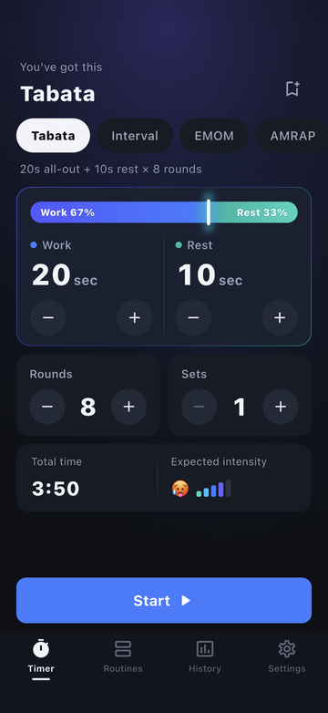
  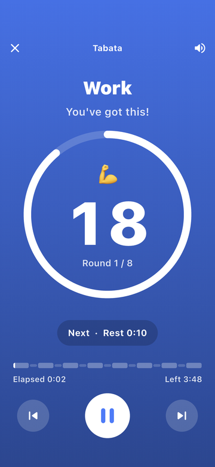
  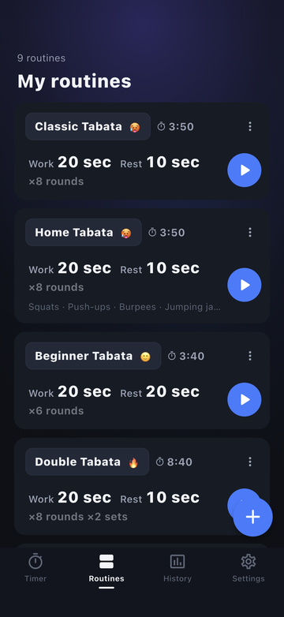
</p>

- **Six timers** with work/rest shown as one card and a live ratio bar
- **Readable from across the room** — full-screen phase colors, a huge countdown, what's next
- **Voice and beeps you don't have to look at** — a beep every second, 3-2-1, and spoken cues (“Go”, “Rest. Next up, burpees”) using the most natural voice on the device
- **Keeps going in the background** — over your music, with the screen off; on Android the notification shows a progress bar
- **Routines and history** — nine built-in routines, exercise names per round, weekly chart, streaks, effort rating
- **Light and dark**, **English and Korean** — follows the device or pick in Settings

Download the Android APK from [Releases](../../releases/latest) (Android 7.0+; signed with a debug key for personal use).
